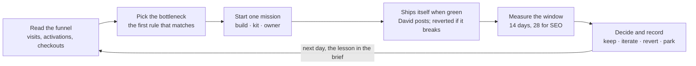

# Growth loop PRD v2

> 2026-10-12 · David Smith. This is a trimmed version of the "RepoHQ Portfolio Director & Continuous
> Improvement System" PRD, grounded in the code and the real funnel. Status: being built in phases (see
> Rollout). The map of the whole system is [system-overview.md](system-overview.md).

The factory builds faster than it distributes: one live product, 3 visitors ever, $0 revenue. v2 adds
one daily growth step to the existing idea pipeline. For each focus product it finds the funnel's
bottleneck, starts one mission, measures the result and records the lesson.

## Where we are

One product is live, and almost nobody has seen it.

| Product | Stage | Price | Funnel | Next step |
|---|---|---|---|---|
| tiebreak | live: MVP and go-live merged | $5 once | 3 unique visitors ever, all on launch day | David: Stripe payment link, then launch posts |
| codespend | MVP, 1 of 3 milestones | $9/month | not live | the weekly build finishes the MVP |
| dawnlog | MVP, 1 of 3 milestones | $12 once | not live | the weekly build finishes the MVP |
| permitly | demand test, decides 2026-10-24 | none yet | 1 of the 50 visitors it needs | posts from its launch kit |
| packpass | demand test, decides 2026-10-26 | none yet | 0 of the 50 visitors it needs | a launch kit, then posts |
| 6 approved ideas | repo created, never built | none yet | none | wait (see Decisions) |

Revenue from ideas is $0. Nothing measures a product after launch, and nothing improves it once its
roadmap is merged. David's one step only he can do, posting, has no daily slot.

## Decisions already made

David set these on 2026-10-12.

- **Focus: tiebreak, then botchelor.** tiebreak was the one live product; botchelor joined on 2026-10-16, once it
  was live on botchelor.com with the funnel beacon. The next product joins once its MVP is live.
- **Finish started MVPs; start no new ones.** The weekly build slot finishes codespend and dawnlog and
  their go-lives. The 6 approved ideas wait for a first build until a focus product reaches 50 visitors
  a week. "Start build now" still works.
- **Demand tests keep running.** Posts from their launch kits appear in the Today block, though they
  aren't focus products.

## The loop

The loop runs inside the existing 15-minute pipeline tick: once a day per focus product, and at most
two missions a day across the portfolio.

## Rules

Each day, the first rule that matches picks a focus product's one mission.

| Stage | When | Mission | Who does it | Metric |
|---|---|---|---|---|
| Launch | not launch-ready yet | none; the automatic go-live build covers it | none | none |
| Instrument | live, but no visit event ever | add visit, activate and checkout events | build | none |
| Acquire | under 50 unique visitors in 7 days | a launch kit, then SEO pages, then "post the next channel" | kit, build, David | visitors |
| Activate | visitors, but no activations or signups | a landing-page or first-run change | build | activations per visitor |
| Monetize | activations, but no checkout clicks | paywall placement or copy; the price stays David's | build | checkouts per visitor |
| Retain | a checkout click or recurring revenue | no missions | none | none |
| Park | the last 2 experiments showed no lift | recommend parking | David | none |

There are three kinds of mission:

- **Build:** a growth build in the product's repo, in the existing sandbox. It opens a draft PR stating
  the hypothesis, metric, current value, target and window. Merging starts the experiment; closing
  abandons it.
- **Kit:** a headless Claude run that follows the launch skill and writes only `LAUNCH-KIT.md`: ranked
  channels, each community's rules, and one post per channel. David posts by hand.
- **Owner:** a line in the Today block.

David's checklist steps (price, payment link, launch posts) are Today items. They never block a mission
or use its slot.

## Measurement

Every live product reports four events to RepoHQ's existing signal endpoint
(`/api/ideas/signal`), with no cookies.

| Event | Fires when | Tells us |
|---|---|---|
| `visit` | any public page opens, once per session | reach |
| `activate` | the product's core action is first used | first real use |
| `checkout` | someone clicks Buy | intent to pay, not a payment |
| `signup` | someone leaves an email | interest (demand tests and lists) |

- The funnel counts unique visitors per event: the last 7 days, the 7 before, and all time, plus the
  top referring sites. Owner, bot and preview traffic don't count.
- **Bursts don't count either** (idea-factory `lib/repohq.js` `cleanSignals`, since 2026-10-16). A burst is an hour in
  which 8 or more different visitors (`policy.growth.burstMinVisitors`) arrive with no referrer and never sign up,
  activate or click Buy: a crawler sweep or a test run. Those visits are left out of the funnel, the experiment windows
  and the demand tests. botchelor.com's first 31 "visitors" arrived within two hours of the domain going live, and 24
  were left out. The 48 hours after a logged launch post still count, because Reddit's app sends no referrer either.
  The funnel records how many were left out (`burst7d`), and the email, the Ideas page and MCP say so. Until an
  experiment starts, its baseline follows the funnel.
- An experiment compares two windows of equal length: before it started and after. Each experiment has a
  minimum sample and an absolute target. Short of data, it is extended once, then recorded as "not
  enough data".
- Revenue is Stripe recurring revenue. One-time payment links such as tiebreak's $5 aren't counted yet;
  a later phase adds them.

## Context

Products share context in three layers, each in a place that already exists.

1. **The product record**, the idea's folder in idea-factory. `state.json` holds the funnel and the
   growth state, including every experiment. `LEARNINGS.md` is an append-only list of what was tried
   and what happened. Both reach RepoHQ's Ideas page and MCP through the existing sync.
2. **The portfolio playbook**, `PLAYBOOK.md`. It holds rules David accepted, plus rules the pipeline
   proposes after a winning experiment. RepoHQ's context search indexes it.
3. **A brief per mission.** Each run gets only what its task needs: the mission, the funnel, the
   product's lessons, the playbook's rules, and how other products' experiments of the same kind turned
   out.

This is how one product's lesson reaches the next. A landing-page change that lifts activations on
tiebreak becomes a proposed rule; once David accepts it, every later landing-page mission sees it.

## David's 10 minutes

The morning email opens with a Today block of at most five items, money first:

- checklist steps for focus products, such as "create tiebreak's Stripe payment link";
- the next channel to post from a launch kit, at most one post a day per product;
- growth PRs the pipeline left for him, with why (it merges the green ones itself);
- whether to park a product whose last two experiments moved nothing;
- playbook rules to accept.

Everything else the system does stays out of the block.

## Guardrails

- **Money:** agents spend nothing. Since 2026-10-12 the owner may fund a product forward (`policy.ownerBudget`, $300 a
  product): a launch kit can propose a paid option (what, how much, targeting, what it should prove), and he
  decides and pays. Claude runs on the subscription only, and growth runs never fall back to the shared free
  model pool.
- **Never post or spend:** kit runs can write one file, with no shell and no MCP. Builds run in the
  sandbox and open PRs. A growth build can only ask David for a credential, never create one.
- **Merging is gated, and reversible** (see Autonomy).
- **Honest distribution:** posts say a builder is asking. Each community's rules decide whether a link
  goes in. No fake accounts, votes or paid placement.
- **Privacy:** prompts and reports carry counts and site names, never emails or visitor hashes.
- **Caps:** at most 2 missions a day and 2 growth builds a week, one per product a day; never on a tick
  that already built; nothing before 10:00. Growth builds use Sonnet, which leaves Opus for MVP builds.
- **One mission in flight per product.** In flight means being built or waiting for David: an open growth
  PR, or a kit nobody has posted from. An experiment being measured doesn't block the next mission, so a
  product can have a kit and search pages running at once. Holding each 14–28-day window alone would take
  about 50 days to get through the beacon, a kit and search pages. Overlapping windows are noted when an
  experiment is judged.

## Autonomy (David's call, 2026-10-12)

David asked for full autonomy: agents merge their own work and carry on, and he reviews what was done each
morning instead of starting sessions or assigning work. His choices: merge scope **everything** (the
factory's PRs and the idea pipeline's, including RepoHQ and idea-factory), failures **reverted
automatically, with Slack told**, and the "draft PRs, David merges" rule **scoped to interactive
sessions**. On 2026-10-13 he dropped that last part too ("full send"): interactive sessions merge their
own PRs once CI is green, and he reviews afterwards.

| | The idea pipeline (`lib/autonomy.js`, `policy.autonomy`) | The factory (`factory/lib/automerge.ts`, config `autonomy`) |
|---|---|---|
| Merges when | its own run of the tests passed, every GitHub check is green, no conflict | every check is green; the preview smoke test, the adversarial reviewer, a `hold` label or a review asking for changes didn't object; no conflict |
| Otherwise | a red growth PR is closed and its mission retried the next day; anything else waits for David (`state.build.held`) | the PR waits for David, with the reason in the morning email's review queue |
| Never merges | PRs touching `.github/workflows/` | PRs touching `factory/`, `.github/workflows/` or the model router |
| Reverts when | the live site's launch checks fail within a day of the merge, or the judge finds an experiment clearly worse | a check on the base branch fails on the merge commit after passing on the commit before it (push runs and commit statuses; scheduled runs don't count) |
| Tells David | Slack for a breakage revert (closed when the site passes again); the morning email for everything | Slack for a revert (closed when the base branch is green again); the morning email for everything |

The morning email opens with **Done overnight**: what the agents merged, reverted and judged in the last
24 hours. Interactive Claude sessions merge their own PRs once CI is green (since 2026-10-13). Nothing
force-pushes or deletes.

## Kept and cut from v1

v2 keeps v1's principles: extend what exists, one executor, no automatic post or spend (merging became
gated and automatic on 2026-10-12, see Autonomy), evidence
over activity, and four levels of measurement (activity, output, outcome, revenue). It cuts the platform
v1 would have built.

| v1 proposed | v2 uses instead |
|---|---|
| a Portfolio Director service | the daily growth step in the existing 15-minute pipeline tick, with next-actions, the Advisor and revenue ranking |
| a 20-field mission contract | one experiment entry: hypothesis, metric, baseline, target, window, result, decision |
| a 9-state lifecycle | idea stages, the 10-step launch checklist and 7 growth stages |
| 10 `.ai` files per repo | `state.json` and `LEARNINGS.md` per product, and one `PLAYBOOK.md` |
| a new dashboard | a Growth card on the Ideas page and the Today block in the morning email |
| an experiments database table | experiments inside each product's `state.json`, mirrored by the existing sync |
| a swarm of role agents | the morning report's roles, and one mission per product at a time |

## Rollout

Each phase shipped as PRs to RepoHQ and idea-factory. Through 2026-10-12 David merged them; since 2026-10-13
the session that opens a PR merges it once CI is green.

1. **Day 0, no code (done 2026-10-12):** tiebreak's first launch kit. Its Stripe payment link went live on 2026-10-13: $5 once, made by the broker with the live key David stored.
2. **Phase 0, fixes (live 2026-10-12):** a bug that can rerun the daily steps; merges on live products
   going untracked; Start build now after a go-live. Also the new-build hold, and the four funnel events
   in RepoHQ and in future go-live builds.
3. **Phase 1, measurement (live 2026-10-12):** the funnel saved for every live product; `LEARNINGS.md`
   and `PLAYBOOK.md`; funnel lines in MCP; the Today block.
4. **Phase 2, the growth step (live 2026-10-12):** the rules, the experiment record, growth builds, kit runs and caps,
   and the Growth card on the Ideas page. tiebreak's first missions: its funnel beacon, then SEO pages
   for searches such as "PickFu alternative".
5. **Phase 3, outcomes, and autonomy (live 2026-10-13):** experiments judged when their window ends, lessons appended,
   playbook rules proposed; the pipeline and the factory merge their own green PRs and revert what breaks;
   the morning email's Done overnight section.
6. **Later:** Search Console, a "mark posted" button, one-time Stripe payments counted as revenue,
   research missions.

## Success and stop criteria

| By | Success looks like |
|---|---|
| 2026-10-26 (2 weeks) | funnel events live on tiebreak; its first kit channel posted; its first experiment running |
| 2026-11-23 (6 weeks) | tiebreak at 50 or more visitors a week; the first checkout click; the first payment |

Parking is recommended, and David decides, when two experiments show no lift on real traffic, or a
product is still under 50 visitors a week after 4 weeks of posting.
